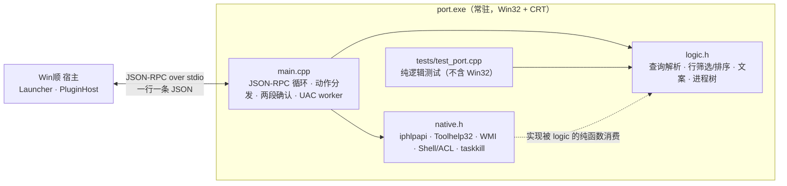
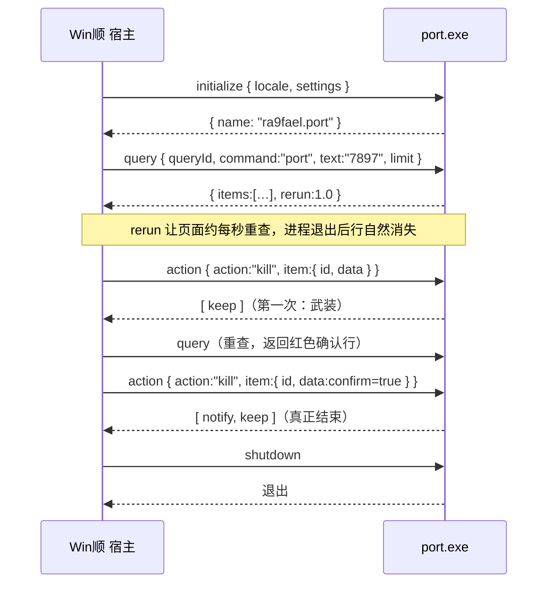
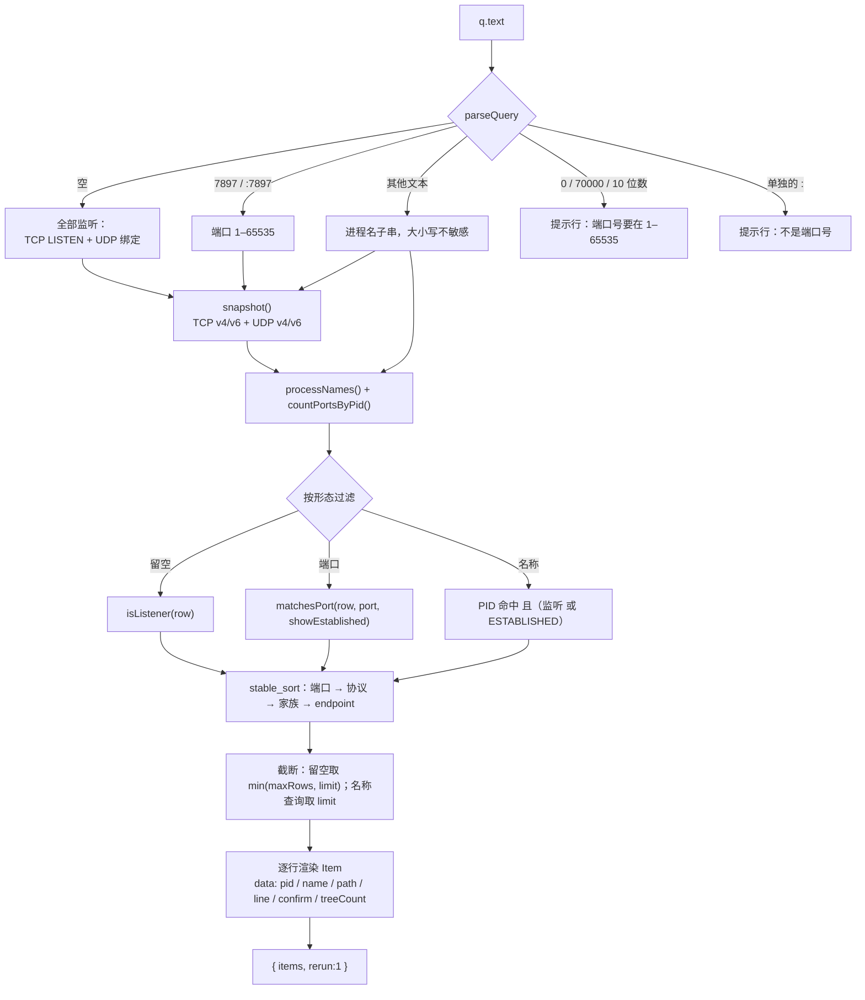
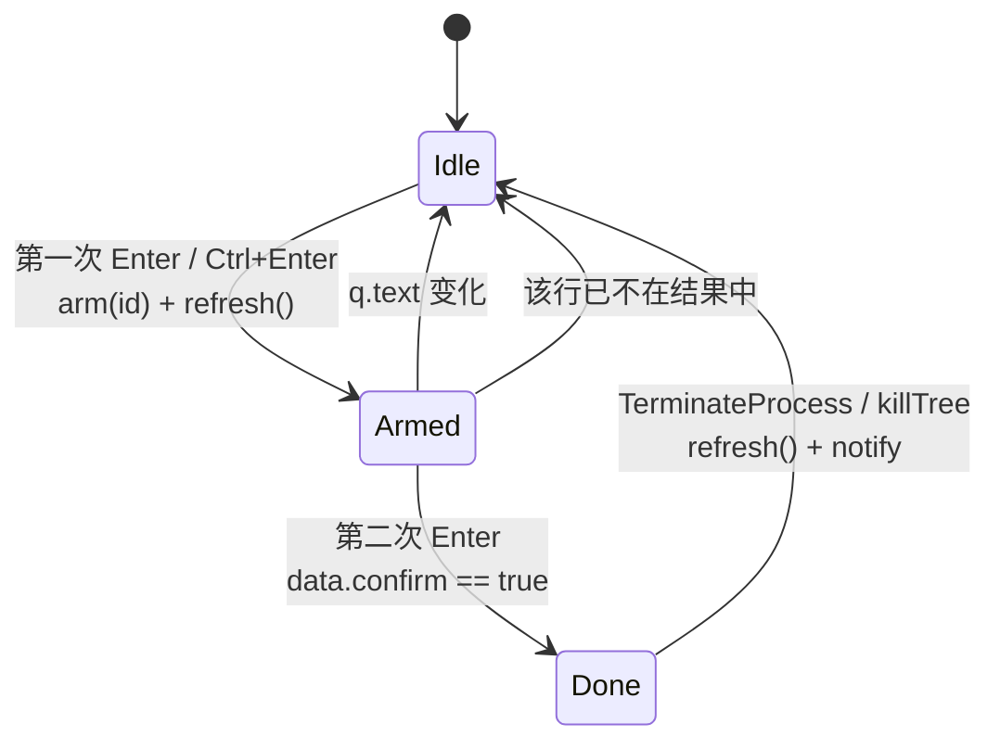
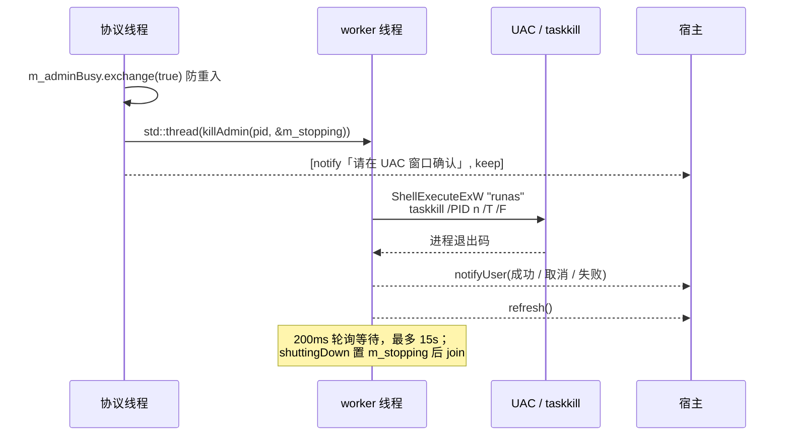
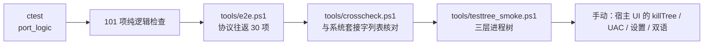

# ra9fael.port 开发文档

面向维护者：架构、协议往返、关键流程、数据来源与已知的坑，以及构建/测试/扩展做法。用户侧说明见[用户指南](guide.md)。

## 技术栈与状态

| 项 | 内容 |
|---|---|
| 语言 / 标准 | C++17，无第三方依赖（不用 Qt，不用 `ui` 权限） |
| 运行时 | 常驻（`runtime.mode = resident`），JSON-RPC over stdio，每行一条消息 |
| 构建 | CMake + Ninja，MSVC，静态 CRT，Release 产物直接落到仓库根 `port.exe` |
| 权限 | `processes`、`clipboard:write`、`elevated` |
| 测试 | `tests/test_port.cpp`（纯逻辑，101 项检查）+ `tools/` 下的协议脚本 |
| 版本 | 0.1.0 |

## 架构



`logic.h` 里没有任何 Win32 调用 —— 所有系统数据都以参数（`SockRow`、`ProcNode`、名字表）注入，因此单测可以在不看系统状态的前提下覆盖每个分支。`native.h` 只做系统调用与结构体解析。

### 代码地图

| 文件 | 职责 | 关键符号 |
|---|---|---|
| [main.cpp](../main.cpp) | 插件类、查询装配、动作、确认、通知 | `PortPlugin::build`、`action`、`rowToItem`、`arm/standDown` |
| [logic.h](../logic.h) | 纯逻辑：解析、匹配、排序、文案、树 | `parseQuery`、`nameMatches`、`isListener`、`rowSubtitle`、`netstatLine`、`collectTree`、`parentChainText` |
| [native.h](../native.h) | 系统调用 | `snapshot`、`processNames`、`processPath`、`killPid`、`killTree`、`commandLineOf`、`killAdmin`、`canListFolderAsShell` |
| [tests/test_port.cpp](../tests/test_port.cpp) | 单测（ctest 的 `port_logic`） | 11 组测试函数 |
| [tools/testtree.cpp](../tools/testtree.cpp) | 三层进程树，供 killTree 手动验证 | `TestTree.exe` |
| [winshun.h](../winshun.h) | 宿主 SDK（单头，逐插件拷贝） | `Json`、`Item`、`Plugin`、`effect::` |

## 协议往返

宿主只在需要时拉起常驻进程（lazy），之后每秒可能重查一次（`rerun`）。



`queryResult()` 不直接实现查询，而是包装 `query()` 并附加 `rerun`：

```cpp
Json queryResult(const Query& q) override
{
    Json::Object result {{"items", itemsJson(build(q))}};
    result["rerun"] = 1.0;
    return Json(std::move(result));
}
```

## 查询流水线



几个约定：

- **行 id** 稳定：`port:tcp:v4:127.0.0.1:7897:2684`，远端命中的 ESTABLISHED 行追加 `:r:<远端>`，两行才能共存
- **系统行**（PID ≤ 4）在渲染时用 `withActions` 覆盖为「管理员结束 + 三个复制」，因为默认 `kill` 一定失败
- **已武装的行**按 id 与 `m_pendingId` 比对渲染；结果里没有它、或 `q.text` 变了，就 `standDown()`

## 动作与两段确认

宿主的动作只有三个键位（`actions` 的下标 0/1/2 对应 Enter / Ctrl+Enter / Shift+Enter），其余动作只出现在右键菜单里。`kill` 与 `killTree` 是危险动作，但宿主没有内建的动作确认框，`valid:false` 又会让 Enter 完全失效 —— 所以确认放在插件侧：



`arm()` 里立即 `refresh()`，宿主重查后就会渲染红色确认行；确认行把 `confirm:true`、`treeCount` 放进 `data` 回传，动作分支据此判断是「武装」还是「执行」。`killTree` 在武装时先取一次 `treePids(pid).size()`，确认标题才能写「共 N 个进程」。

## UAC 线程模型

`ShellExecuteExW(..., "runas")` 会一直阻塞到用户在 UAC 窗口做出选择，**绝不能跑在协议线程上**（否则整个插件停止响应）：



关闭流程 `shuttingDown()` 先停 worker（`m_stopping` + join），再让 `serve()` 返回；`main()` 里 `CoInitializeEx(COINIT_MULTITHREADED)` 只做一次，WMI 与 Shell 都依赖它。

## 数据来源

| 用途 | API | 要点 |
|---|---|---|
| TCP 行 | `GetExtendedTcpTable(TCP_TABLE_OWNER_PID_ALL, AF_INET / AF_INET6)` | v4 与 v6 是两套结构体，v6 地址是 `ucLocalAddr[16]` |
| UDP 行 | `GetExtendedUdpTable(UDP_TABLE_OWNER_MODULE, v4 / v6)` | v6 是 `MIB_UDP6ROW_OWNER_MODULE` |
| 进程名 / 父进程 | `CreateToolhelp32Snapshot(TH32CS_SNAPPROCESS)` | 一次快照同时喂给名字表、`collectTree`、`parentChainText` |
| 路径 | `QueryFullProcessImageNameW(PROCESS_QUERY_LIMITED_INFORMATION)` | 拒绝访问 → 返回空串，行里省略 |
| 命令行 | WMI `Win32_Process.CommandLine` | `CoSetProxyBlanket` 后才能查；失败只提示，不报错 |
| 结束 | `OpenProcess(PROCESS_TERMINATE)` + `TerminateProcess` | 结束前 `WaitForSingleObject(1000)`，行消失才算成功 |
| 结束进程树 | Toolhelp32 父链 + 逐 PID `TerminateProcess` | 广度优先，父先于子 |
| 提权结束 | `ShellExecuteExW("runas", taskkill /PID n /T /F)` | 见线程模型 |
| 目录可读性 | Explorer 令牌 + `AccessCheck` | 见下一节 |

## 已知的坑

**1. `OWNER_MODULE` 表的 `dwState` 恒为 0。** 在当前 Windows 构建上，`TCP_TABLE_OWNER_MODULE_ALL` 返回的每一行 `dwState` 都是 0，照它判断会把所有 TCP 行当成非监听。所以 TCP 用 `OWNER_PID` 表；模块信息本来也不需要（路径走进程 API）。

```cpp
// native.h
::GetExtendedTcpTable(buffer.data(), &size, FALSE, family, TCP_TABLE_OWNER_PID_ALL, 0);
```

**2. 即使是 `OWNER_PID`，仍有权衡后的 `dwState = 0`。** 本机对已绑定但未连接的套接字会报 0，`netstat -ano` 干脆把这类行隐藏。插件用「远端地址全零且远端端口为 0」判定为监听，显示时补成 `LISTEN`：

```cpp
// logic.h
inline bool isListener(const SockRow& row)
{
    if (row.proto == "UDP") return true;
    if (row.state == "LISTEN") return true;
    return (row.state.empty() || row.state == "CLOSED") && isRemoteEmpty(row);
}
```

**3. 提权进程的可读 ≠ 资源管理器的可读。** 插件由宿主以管理员身份启动，但 `explorer.exe` 始终以登录用户运行。定位/打开目录前必须用 **Explorer 自己的令牌**（`GetShellWindow` → `OpenProcess` → `OpenProcessToken`）做 `AccessCheck`；拿不到 shell 令牌才退回 `CreateRestrictedToken(LUA_TOKEN)`。如果连 DACL 都读不到（`GetNamedSecurityInfoW` 失败），且当前进程已提权，一律判为不可读 —— 否则会放行，让资源管理器弹「拒绝访问」。判定结果会写进 stderr（宿主存为 `plugins.log`）：

```
ra9fael.port stderr: port: reveal blocked C:\ProgramData\clash-verge-service\cores
```

**4. UAC 会阻塞。** 见线程模型；不要在协议线程里同步等待提权。

**5. 两段确认是设计，不是 bug。** 宿主没有动作确认框；把行设成 `valid:false` 会让 Enter 静默失效。插件选择「第一次武装、第二次执行」，并用 `rerun` 让页面重查以渲染确认行。

**6. 武装状态按查询文本保持。** `build()` 在 `q.text` 变化或该行消失时清除 `m_pendingId` —— 否则换查询后按下 Enter 可能结束上一屏的进程。

**7. PowerShell 5.1 给子进程 stdin 加 BOM。** 用 PS 5.1 的重定向 stdin 发第一条 JSON 会被插件判为「不是 JSON」（插件是对的，真实宿主不会发 BOM）。协议脚本因此在 pwsh 7 下运行，并直接写 `BaseStream` 字节。

## 构建

```powershell
# 在 VS 开发者 PowerShell 中
cmake -S . -B build -G Ninja -DCMAKE_BUILD_TYPE=Release
cmake --build build            # port.exe 落在仓库根
ctest --test-dir build -C Release
```

| 目标 | 产物 | 说明 |
|---|---|---|
| `port` | `./port.exe` | 插件本体，静态 CRT，无运行时 DLL |
| `port_tests` | `build/tests/port_tests.exe` | ctest 的 `port_logic` |
| `TestTree` | `build/tools/TestTree.exe` | 仅手动验证用，不随包发布 |

## 测试



- 单测覆盖：查询解析、名称匹配、v4/v6 地址格式、状态映射、监听判定、匹配与排序、聚合标注、行文案、netstat 行、父进程链、树收集、设置解析
- `tools/e2e.ps1`：起一个临时监听进程，验证 initialize → 名称/端口查询 → 四个复制动作 → 不可读目录/文件消失 → 两段确认 kill → 空查询排序 → shutdown
- `tools/crosscheck.ps1`：把空查询的每一行与 `Get-NetTCPConnection` / `Get-NetUDPEndpoint` 对照（不用 `netstat`，因为它会隐藏 `dwState=0` 的行）；双栈监听允许按「协议 + 端口 + PID」匹配
- 手动项清单与勾选状态见[测试规格](tests.md)

## 扩展指南

**加一个动作**

1. `plugin.json` 的 `commands[0].actions` 末尾追加 `{"id","title","key":""}`（`key` 只有前三个有位置意义）
2. 行需要携带的数据放进 `rowToItem` 的 `withData`
3. 在 `PortPlugin::action()` 里加一个 `if (a.action == "…")` 分支，返回 `Effects`
4. 若涉及系统调用，放 `native.h`；若产生文本/判定，放 `logic.h` 并补单测

**加一种查询形态**

1. `ParsedQuery` 加字段，`parseQuery` 增加分支（注意「数字 / `:数字` / 其它」的既有优先级）
2. `build()` 里加筛选分支，保持 `rowLess` 的排序与截断规则
3. 补提示行文案（中英各一）与单测用例

**加一个设置**

1. `plugin.json` 的 `settings` 加 `{"key","type","title","default"}`
2. `Settings` 结构体 + `readSettings()` 读取并夹取范围
3. 在使用处读 `m_settings`，`initialized()` / `settingsChanged()` 已经会同步

## 文档地图

| 文档 | 内容 |
|---|---|
| [用户指南](guide.md) | 安装、查询语法、动作、FAQ |
| [功能规格](spec.md) | 目标、命令、动作、权限、里程碑 |
| [测试规格](tests.md) | 单测/协议/手动项与验收标准 |
| [发布与安装](release.md) | 打包清单、SHA-256、升级与回滚 |
