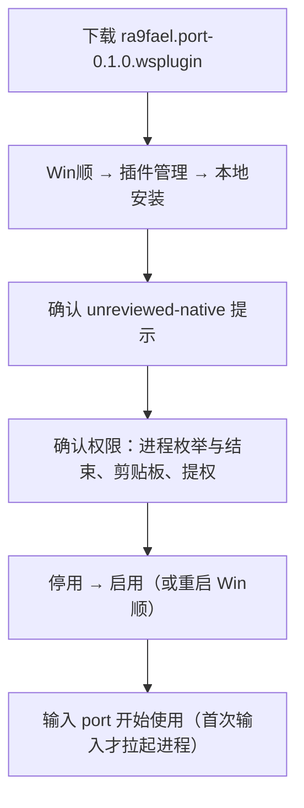
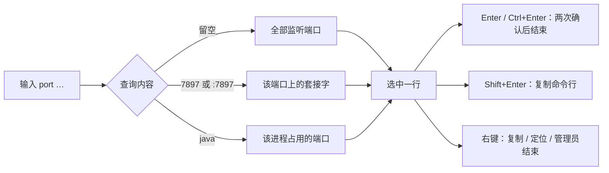
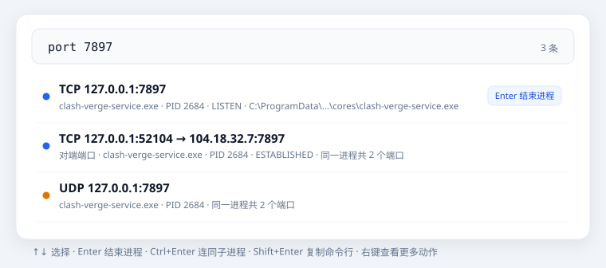
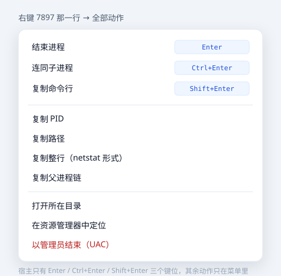
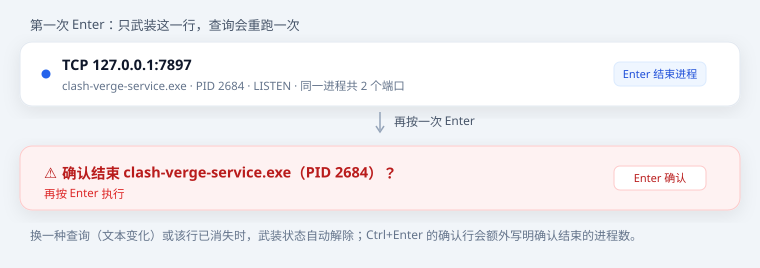
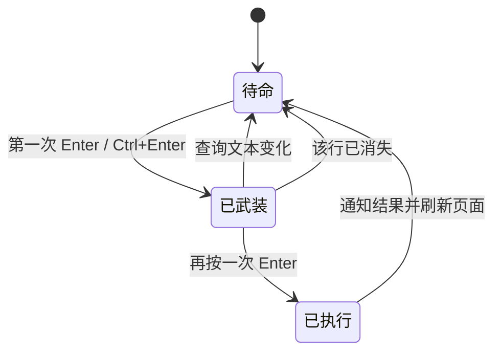

# ra9fael.port 用户指南

「端口被谁占了」一步到位：输入 `port 7897` 看进程，确认后直接结束；也可以反过来用 `port java` 查某个进程占了哪些端口。

- 纯 Windows 原生实现（iphlpapi + 进程 API），不解析 `netstat` 文本，不联网、不落盘
- 与内置的 `winshun.kill`（按名字/PID 杀）互补，补上「端口」这一维度

## 安装

手工安装：把 `plugin.json`、`port.exe`、`README.md`、`LICENSE` 复制到 `%LOCALAPPDATA%\WinShun\plugins\ra9fael.port\`，再重启 Win顺。

> 插件的权限声明是 `processes`、`clipboard:write`、`elevated`，没有 `ui`、没有 `network`。「elevated」表示你允许宿主用管理员身份运行它，宿主不会替你弹 UAC；只有你点「以管理员结束」时才会出现 UAC 窗口。

## 快速上手

## 查询语法

| 输入 | 含义 |
|---|---|
| `port` / `端口` | 列出全部监听：TCP `LISTEN` + UDP 已绑定，按端口升序，最多 `maxRows` 行 |
| `port 7897` / `port :7897` | 本地端口为 7897 的 TCP + UDP、v4 + v6 |
| `port java` | 进程名包含 `java` 的进程（大小写不敏感）所占的监听行与活动连接 |
| `port 70000` | 提示「端口号要在 1–65535 之间」 |
| `port :` | 提示「不是端口号」 |
| `port abc` 且查无此进程 | 提示「没有名字含「abc」的进程」 |

开启「显示已建立的连接」（默认开）后，端口查询还会列出**远端端口**等于该端口的 ESTABLISHED 行，并在行内标「对端端口」。

## 一行怎么读

| 位置 | 内容 | 说明 |
|---|---|---|
| 标题 | `TCP 127.0.0.1:7897` | v6 写成 `[::]:7897`；已建立连接写成 `TCP 本地 → 远端` |
| 副标题 | 进程名 · PID · 状态 · 路径 · 端口数 | 读不到路径时省略；同一 PID 占多个端口时注明「同一进程共 N 个端口」 |
| 左侧圆点 | 蓝 / 橙 / 灰 | 依次为 TCP、UDP、系统级条目（PID 4 等） |
| 右侧提示 | `Enter 结束进程` | 底部栏只展示前三个快捷键 |

## 动作

| 动作 | 触发 | 做什么 |
|---|---|---|
| 结束进程 | Enter | `TerminateProcess`，作用于整个 PID |
| 连同子进程 | Ctrl+Enter | 按父进程链收集子孙进程后依次结束 |
| 复制命令行 | Shift+Enter | 通过 WMI 读 `Win32_Process.CommandLine` |
| 复制 PID | 右键菜单 | 只复制数字，便于粘到任务管理器/日志 |
| 复制路径 | 右键菜单 | 复制 exe 完整路径 |
| 复制整行 | 右键菜单 | 复制成 `netstat -ano` 风格的一行，便于贴进工单 |
| 复制父进程链 | 右键菜单 | 例：`python.exe (1234) ← cmd.exe (5678) ← explorer.exe (9012)` |
| 打开所在目录 | 右键菜单 | 用宿主的 open 打开 exe 所在文件夹 |
| 在资源管理器中定位 | 右键菜单 | 打开目录并选中该 exe |
| 以管理员结束（UAC） | 右键菜单 | 提权执行 `taskkill /PID n /T /F` |

系统级行（PID 4、PID 0）没有默认的 `kill` / `killTree`，只保留管理员路径 —— 结束 System 的监听本来就需要管理员权限。

## 危险操作要按两次

宿主没有「动作确认」对话框，所以确认由插件自己完成：第一次 Enter **只武装**该行，列表重跑一次并把它渲染成红色确认行；再按一次 Enter 才真正结束。

武装状态只记在该行上：换一个查询、或者那个进程自己退出了，确认状态都会自动解除。

## 设置

| 设置 | 默认 | 作用 |
|---|---|---|
| 显示已建立的连接 `showEstablished` | 开 | 端口查询是否带上对端命中的 ESTABLISHED 行 |
| 显示系统级条目 `showSystem` | 开 | 是否显示 PID 4 等看不到进程信息的监听 |
| 留空查询最多行数 `maxRows` | 30 | 10–200，只影响留空查询 |

## 常见问题

**查不到我想要的端口？**
先确认端口确实被占用（`netstat -ano | findstr :7897`）。如果 netstat 也没有，那就是没人监听。若 netstat 有、而插件没有，请反馈：这属于表快照的差异，插件按「无对端即监听」判定，不该漏。

**行里没有路径？**
该进程不允许普通权限读取镜像路径（系统进程、受保护进程）。插件选择省略而不是报错；「以管理员结束」不受影响。

**为什么点「定位」提示没有访问权限？**
那个目录的 ACL 不允许普通用户读（典型是系统服务目录，如 `C:\ProgramData\clash-verge-service\cores`），而资源管理器是以你本人权限打开的。插件此时会**复制路径并提示**，不再弹资源管理器的「拒绝访问」框。
需要真正进去看：在资源管理器里打开该目录，点提示框里的「继续」永久授权；否则只能复制路径到管理员环境里使用。

**第一次按 Enter 没反应？**
这是设计如此：第一次只武装，红色确认行出现后再按一次才结束。

**提示「没有权限结束它」？**
该进程属于其他用户或系统服务，用「以管理员结束（UAC）」，在 UAC 窗口点「是」。

**为什么 PID 4 的行没有「结束进程」？**
System 进程只能由提权路径结束，默认的 `kill` 一定会失败，所以只给「以管理员结束」。

**为什么这一行在 netstat 里看不到？**
本机部分已绑定套接字在系统表里 `dwState=0`，`netstat` 会直接隐藏这类行；插件按「无对端即监听」把它们列出来并显示为 `LISTEN`。详见[开发文档](develop.md#已知的坑)。

**结束一个进程会影响它的其他端口吗？**
会。`kill` / `killTree` 作用于整个进程，不区分端口；行内「同一进程共 N 个端口」就是提醒这一点。

## 卸载

宿主里停用并删除插件，或直接删掉 `%LOCALAPPDATA%\WinShun\plugins\ra9fael.port\` 后重启。插件不写数据目录、不改系统配置，卸载无残留。

---

更多：[开发文档](develop.md) · [功能规格](spec.md) · [测试规格](tests.md) · [发布与安装](release.md)
