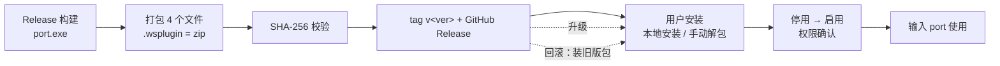

# ra9fael.port 发布与安装流程



## 构建

纯 Win32 + CRT 的 `port.exe`（静态链接 CRT，链接 iphlpapi/advapi32/ole32 等），无 Qt 依赖，manifest 不声明 `runtime.qt`。

```powershell
cmake -S . -B build -G Ninja -DCMAKE_BUILD_TYPE=Release
cmake --build build
```

产物落在仓库根（与 plugin.json 同目录）。

## 打包（.wsplugin）

1. 确认 `plugin.json` 的 `version` 与发布 tag 一致
2. `dist/ra9fael.port-<ver>.wsplugin` = zip，包含且仅包含：
   - `plugin.json`
   - `port.exe`
   - `README.md`
   - `LICENSE`
3. 计算 SHA-256：`Get-FileHash dist\ra9fael.port-<ver>.wsplugin`

## 发布

1. 先手动运行 `release.yml`，指定源码 `ref` 且 `publish=false`；通过后创建并单独推送 `v<ver>` 标签：`git tag -a v<ver> -m "Release v<ver>"`、`git push origin v<ver>`
2. GitHub Actions 自动创建 Release `v<ver>` 并上传 `.wsplugin`；release notes 写变更点、SHA-256、构建命令，并注明：kill 为危险操作需确认，系统级监听（PID 4 等）结束需 UAC
3. 声明为社区原生包（`unreviewed-native`）

## 安装（用户）

- 方式 A（宿主界面）：Win顺 → 插件管理 → 本地安装 → 选择 `.wsplugin` → 确认（unreviewed-native 提示）→ 停用再启用插件（或重启宿主）
- 方式 B（手动）：解包到 `%LOCALAPPDATA%\WinShun\plugins\ra9fael.port\`（`plugin.json` 必须在目录根部）→ 重启 Win顺
- 首次启用弹权限确认（进程枚举/结束、剪贴板、提权）；lazy 启动，首次输入 `port` 才拉起进程

## 升级

- 覆盖安装新版 `.wsplugin`，或替换目录内文件后停用/启用插件
- 无数据迁移（不持久化）

## 卸载

- 宿主中停用 + 删除，或直接删除插件目录后重启宿主
- 残留：无（不写数据目录、不动系统配置）

## 回滚

- GitHub Release 保留历史版本；下载旧 `.wsplugin` 覆盖安装即可


当前发布入口仅为新版本 tag 与手动运行。新 tag 会自动构建、测试、打包并发布；已有 tag 更新/删除、分支 push 和 PR 不触发。手动发布须指定已有版本 tag 并设置 `publish=true`，不得覆盖已有 Release 附件。完整参数见 [WORKFLOWS.md](../WORKFLOWS.md)。
